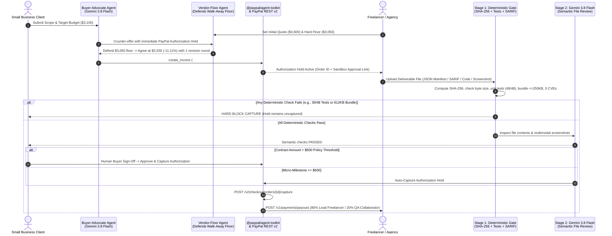

<div align="center">

# ⚡ PayPulse AI

### **Hold-Then-Capture Milestone Payments for Small Businesses Hiring Freelancers & Agencies**

*Powered by **`@paypal/agent-toolkit`**, **PayPal Orders v2 (`intent: AUTHORIZE`)**, **PayPal Invoicing v2**, **PayPal Payouts v1**, **Google Gemini 3.8 Flash (`@google/genai`)**, and **AG Grid Community v33**.*

[](./LICENSE)
[](https://www.npmjs.com/package/@paypal/agent-toolkit)
[](https://developer.paypal.com)
[](https://ai.google.dev/gemini-api/docs)
[](https://www.ag-grid.com)
[](https://render.com/deploy?repo=https://github.com/Kabirroy12345/paypulse-ai-paypal-)

</div>

---

## 💡 The Problem We Solve

When a small business (an indie e-commerce shop, clinic, or studio) hires a freelance developer or boutique agency for a **$400–$5,000 project milestone**, both sides face a costly trust and coordination gap:

1. **Upfront Risk vs. Net-30 Friction:** Small businesses hesitate to pay 100% upfront before code or design deliverables are verified, while freelancers refuse to start work without knowing the client's funds are committed.
2. **Opaque Rate Negotiation:** Clients and agencies spend days going back and forth over quotes, rush fees, and revision limits without structured price discovery.
3. **Unsafe "AI Auto-Payouts" vs. Manual QA:** Naive agentic payment demos claim to auto-release funds based on an LLM's self-reported "confidence percentage." In real commerce, **LLM confidence is uncalibrated**—releasing money without deterministic verification and human sign-off is a non-starter.
4. **Manual Subcontractor Splits:** When a lead freelancer collaborates with an independent QA engineer or UX specialist, splitting the final milestone payout requires manual secondary transfers and spreadsheet reconciliation.

---

## 🛡️ How PayPulse AI Works (And Why It's Built for Real Commerce)

**PayPulse AI** is a **two-sided milestone payment workspace** (with dedicated **Small Business Client** and **Freelancer / Agency** views) that pairs PayPal's native `intent: "AUTHORIZE"` hold-then-capture lifecycle with deterministic code checks, Gemini 3.8 Flash semantic inspection, and human-in-the-loop policy gates:

| Design Pillar | Naive "AI Escrow" Demos | **PayPulse AI (Production-Grade Architecture)** |
| :--- | :--- | :--- |
| **Payment Mechanism** | Mislabels standard checkout as "escrow" | Uses PayPal's native **`intent: "AUTHORIZE"` Authorization Hold** (`POST /v2/checkout/orders`), capturing funds (`/capture`) only after milestone verification and disbursing subcontractor shares via **PayPal Payouts v1** (`POST /v1/payments/payouts`). |
| **Agent Negotiation** | Hardcodes a scripted ~15% discount | Runs a **Two-Agent Negotiation** where the freelancer's `Vendor-Floor-Agent` defends a hard walk-away cost floor (`vendorPriceFloorUsd`). Discounts vary naturally (`6.25%`, `8.33%`, `11.11%`, `14.29%`) based on the actual spread between quote, budget, and floor. |
| **Deliverable Verification** | Trusts an uncalibrated LLM "confidence >= 85%" score | Enforces a **3-Stage Verification Pipeline**:<br/>1. **Deterministic Code Gate** (`SHA-256` digest, byte size, unit test pass counts, bundle size cap `<= 250 KB`, SARIF `0` Critical/High CVEs)<br/>2. **Gemini 3.8 Flash Semantic File Inspection**<br/>3. **Human Buyer Sign-Off Gate** for any contract **`> $500`**. |
| **PayPal Agent Tooling** | Custom mock wrappers | Integrates PayPal's official **`@paypal/agent-toolkit`** (`create_invoice`, `create_order`, `pay_order`) with full tool-call tracing in the UI. |

---

## 🏗️ End-to-End Architecture & Sequence Flow



---

## 🔍 Codebase Map for Judges

Click any file below to inspect the implementation directly:

| Module / Capability | File Path | What It Implements |
| :--- | :--- | :--- |
| **PayPal Agent Toolkit & REST v2 Engine** | [`src/lib/paypal-server.ts`](./src/lib/paypal-server.ts) | Instantiates `PayPalAgentToolkit` (`@paypal/agent-toolkit/openai`) with `ALL_TOOLS_ENABLED`, OAuth2 token exchange (`/v1/oauth2/token`), Orders v2 (`intent: "AUTHORIZE"` & `/capture`), Invoicing v2 (`create_invoice`), and Payouts v1 (`/v1/payments/payouts`). |
| **Deterministic + Gemini Verification Gate** | [`src/lib/verification-engine.ts`](./src/lib/verification-engine.ts) | **Stage 1**: Node.js `crypto` `SHA-256` hashing, byte-size validation, unit test pass verification, bundle cap check (`<= 250 KB`), and SARIF CVE parser.<br/>**Stage 2**: `@google/genai` (`gemini-3.8-flash`) semantic & multimodal file review.<br/>**Stage 3**: Immutable audit trail builder & `> $500` human sign-off routing. |
| **Two-Agent Floor-Bounded Negotiation** | [`src/lib/gemini-agents.ts`](./src/lib/gemini-agents.ts) | Uses `@google/genai` (`client.interactions.create` with `gemini-3.8-flash` and structured JSON `response_format`) to negotiate between the client's budget and the freelancer's walk-away price floor. |
| **AG Grid Community v33 Command Center** | [`src/components/PayPulseAgGrid.tsx`](./src/components/PayPulseAgGrid.tsx) | Custom React cell renderers (Quote vs. Floor, Authorization Hold status badges, Deterministic Rule counters, inline **"Buyer Sign-Off"** & **"Inspect File"** actions), `pinnedBottomRowData` totals, `enableCellChangeFlash`, quick search, and CSV export (`exportDataAsCsv`). |
| **Two-Sided Hold-Then-Capture Workbench** | [`src/components/PayPalEscrowWorkbench.tsx`](./src/components/PayPalEscrowWorkbench.tsx) | Interactive `@paypal/react-paypal-js` Smart Buttons (`intent: "authorize"`), real file uploader, Stage 1–3 verification breakdown, Human Buyer Sign-Off panel, Split Payout cards, and `@paypal/agent-toolkit` trace viewer. |
| **Real Deliverable Test Files** | [`public/sample-deliverables/`](./public/sample-deliverables/) | Contains [`shopify-checkout-audit-PASS.json`](./public/sample-deliverables/shopify-checkout-audit-PASS.json) (`48/48` tests, `184 KB` bundle, `0` CVEs) and [`shopify-checkout-audit-DEFECTIVE.json`](./public/sample-deliverables/shopify-checkout-audit-DEFECTIVE.json) (`39/48` tests, `612 KB` bundle, `1` Critical CVE). |

---

## 🧪 90-Second Judge Evaluation Walkthrough

Once the app is running (locally or via the hosted URL), you can test all three core scenarios in under 90 seconds:

### 1. Test Variable Discount Negotiation Against a Freelancer's Price Floor
- In the right-hand **New Milestone Contract** panel, click between the 3 preset scenarios:
  - **Scenario 1 (`$3,800 Quote` vs `$3,250 Floor`)**: Settles around `~11–14%` discount.
  - **Scenario 2 (`$480 Micro-Milestone` `<= $500` Auto-Capture Threshold)**: Eligible for automatic capture once deterministic checks pass.
  - **Scenario 3 (`$2,100 Quote` vs `$1,960 Tight Floor`)**: Watch the Vendor Agent defend its `$1,960` labor floor even when the buyer asks for `$1,800`, settling near `~5–6%` discount.
- Click **"Negotiate vs Vendor Floor & Create PayPal Hold"** to watch the new contract stream into **AG Grid Community v33** with its PayPal Order ID and Invoice number.

### 2. Test a Real Broken Deliverable File (Deterministic Hard-Block)
- Toggle the top header switch to **Freelancer / Agency (Vendor)**.
- In the workbench under **Deliverable Artifact File**, click **`Load Broken File (39/48 Tests, 612KB, 1 CVE)`** (or upload any `.json`/code file from your computer) and click **`1. Inspect "shopify-checkout-audit-DEFECTIVE.json"`**.
- Watch **Stage 1 (Deterministic Programmatic Checks)** compute the file's `SHA-256` hash (`e3b0c44298fc…`), catch the 9 failing unit tests, the `612 KB` oversized bundle, and the `1` Critical SARIF vulnerability, and **hard-block PayPal Order capture in code**.

### 3. Test a Passing Deliverable File + Human Buyer Sign-Off (`> $500`) + Split Payout
- Click **`Load Passing File (48/48 Tests)`** and click **`1. Inspect "shopify-checkout-audit-PASS.json"`**.
- All 5 deterministic checks (`48/48` tests, `184 KB <= 250 KB`, `0` CVEs) and the Gemini 3.8 Flash review pass.
- Because the contract value exceeds the **`$500` auto-capture policy cap**, the contract transitions to **`AWAITING BUYER SIGN-OFF`**.
- Toggle back to **Small Business Client (Buyer)** and click the gold **`2. Approve & Capture PayPal Hold`** button.
- PayPulse AI captures the PayPal Order and executes a **Multi-Party Split Payout** (`POST /v1/payments/payouts`), disbursing `80%` to the lead freelancer and `20%` to the QA collaborator, and logs the human sign-off + `SHA-256` hash in Tab 4 (**`@paypal/agent-toolkit` & SHA-256 Trail**).

---

## 🚀 Local Setup & Installation

### Prerequisites
- **Node.js** `>= 18.18.0` (tested on Node v20 and v24)
- **npm** `>= 9.0.0`

### 1. Clone & Install Dependencies
```bash
git clone https://github.com/Kabirroy12345/paypulse-ai-paypal-.git
cd paypulse-ai-paypal-
npm install
```

### 2. Configure Environment Variables
Copy `.env.example` to `.env.local`:
```bash
cp .env.example .env.local
```

Fill in your credentials in `.env.local` *(or paste them at runtime via the **API Keys** button in the top-right navigation bar)*:

| Variable | Required | Description |
| :--- | :--- | :--- |
| `PAYPAL_CLIENT_ID` | Recommended | Your PayPal Sandbox Client ID from the [PayPal Developer Dashboard](https://developer.paypal.com/dashboard/applications/sandbox). |
| `PAYPAL_CLIENT_SECRET` | Recommended | Your PayPal Sandbox Client Secret for OAuth2 & `@paypal/agent-toolkit`. |
| `NEXT_PUBLIC_PAYPAL_CLIENT_ID` | Optional | Enables live `@paypal/react-paypal-js` Smart Payment Buttons (`intent: "authorize"`) in the browser. |
| `GEMINI_API_KEY` | Recommended | Your Google Gemini API Key from [Google AI Studio](https://aistudio.google.com/apikey) for `gemini-3.8-flash`. |

### 3. Run the Development Server
```bash
npm run dev
```
Open **[http://localhost:3000](http://localhost:3000)** in your browser.

### 4. Production Build Check
```bash
npm run build
npm run start
```

---

## ☁️ Deploying to Render (1-Click Blueprint)

This repository includes a [`render.yaml`](./render.yaml) Blueprint at the project root:
1. Go to [Render Dashboard -> Blueprints](https://dashboard.render.com/blueprints) and connect `https://github.com/Kabirroy12345/paypulse-ai-paypal-`.
2. Enter `PAYPAL_CLIENT_ID`, `PAYPAL_CLIENT_SECRET`, `NEXT_PUBLIC_PAYPAL_CLIENT_ID`, and `GEMINI_API_KEY` when prompted.
3. Click **Apply** to deploy your live hosted URL.

---

## 📄 License

Distributed under the **MIT License**. See [`LICENSE`](./LICENSE) for full details.
