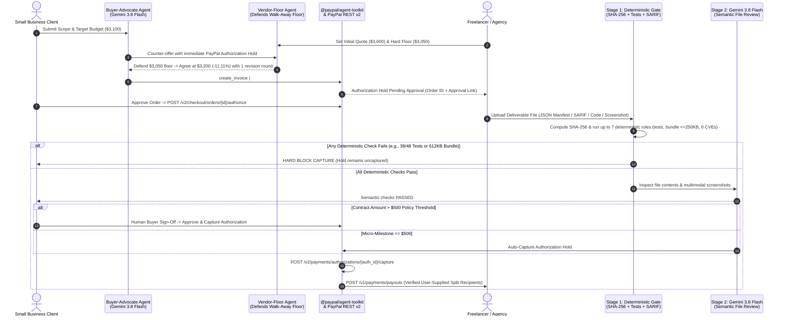

<div align="center">

# ⚡ PayPulse AI

### **Hold-Then-Capture Milestone Payments for Small Businesses Hiring Freelancers & Agencies**

*Powered by **`@paypal/agent-toolkit`**, **PayPal Orders v2 (`intent: AUTHORIZE`)**, **PayPal Invoicing v2**, **PayPal Payouts v1**, **Google Gemini 3.8 Flash (`@google/genai`)**, and **AG Grid Community v33**.*

[](./LICENSE)
[](https://www.npmjs.com/package/@paypal/agent-toolkit)
[](https://developer.paypal.com)
[](https://ai.google.dev/gemini-api/docs)
[](https://www.ag-grid.com)
[](https://render.com/deploy?repo=https://github.com/Kabirroy12345/paypulse-ai-paypal-)

</div>

---

## 💡 The Problem We Solve

When a small business (an indie e-commerce shop, clinic, or studio) hires a freelance developer or boutique agency for a **$400–$5,000 project milestone**, both sides face a costly trust and coordination gap:

1. **Upfront Risk vs. Net-30 Friction:** Small businesses hesitate to pay 100% upfront before code or design deliverables are verified, while freelancers refuse to start work without knowing the client's funds are committed.
2. **Opaque Rate Negotiation:** Clients and agencies spend days going back and forth over quotes, rush fees, and revision limits without structured price discovery.
3. **Unsafe "AI Auto-Payouts" vs. Manual QA:** Naive agentic payment demos claim to auto-release funds based on an LLM's self-reported "confidence percentage." In real commerce, **LLM confidence is uncalibrated**—releasing money without deterministic verification and human sign-off is a non-starter.
4. **Manual Subcontractor Splits:** When a lead freelancer collaborates with an independent QA engineer or UX specialist, splitting the final milestone payout requires manual secondary transfers and spreadsheet reconciliation.

---

## 🛡️ How PayPulse AI Works (And Why It's Built for Real Commerce)

**PayPulse AI** is a **two-sided milestone payment workspace** (with dedicated **Small Business Client** and **Freelancer / Agency** views) that pairs PayPal's native `intent: "AUTHORIZE"` hold-then-capture lifecycle with deterministic code checks, Gemini 3.8 Flash semantic inspection, and human-in-the-loop policy gates:

| Design Pillar | Naive "AI Escrow" Demos | **PayPulse AI (Production-Grade Architecture)** |
| :--- | :--- | :--- |
| **Payment Mechanism** | Mislabels standard checkout as "escrow" | Uses PayPal's native **`intent: "AUTHORIZE"` Authorization Hold** (`POST /v2/checkout/orders`), requiring buyer approval + `/authorize`, capturing funds (`/capture`) only after milestone verification, and disbursing shares via **PayPal Payouts v1** (`POST /v1/payments/payouts`). |
| **Server-Side Trust Boundary** | Trusts deal JSON, amounts, and payout emails sent from the browser | Stores every contract **server-side** in an HTTP-only session store ([`src/lib/deal-store.ts`](./src/lib/deal-store.ts)) with per-deal mutex locks. `/api/agent/audit` accepts only `dealId` and the deliverable file—the server never trusts client-supplied amounts, audit flags, or recipient addresses. |
| **Agent Negotiation** | Hardcodes a scripted ~15% discount & hardcoded payout splits | Runs a **Two-Agent Negotiation** where the freelancer's `Vendor-Floor-Agent` defends a hard walk-away cost floor (`vendorPriceFloorUsd`) and server-clamped clearing range. Split payout recipients come **strictly from validated user input** (no hardcoded/AI-invented payout emails). |
| **Deliverable Verification** | Trusts an uncalibrated LLM "confidence >= 85%" score | Enforces a **3-Stage Verification Pipeline**:<br/>1. **Deterministic Code Gate** (`SHA-256` digest, byte size `> 32B`, schema validation, unit & integration tests, bundle cap `<= 250 KB`, Lighthouse score, SARIF `0` Critical/High CVEs)<br/>2. **Gemini 3.8 Flash Semantic File Review**<br/>3. **Human Buyer Sign-Off Gate** for any contract **`> $500`**. |
| **PayPal Agent Tooling & Mode Honesty** | Custom mock wrappers & silent fake "SUCCESS" states | Integrates PayPal's official **`@paypal/agent-toolkit`** (`create_invoice`, etc.) + Sandbox REST v2/v1 (`PAYPAL_ENVIRONMENT=sandbox` enforced server-side). Demo & unconfigured contracts are labeled **`SIMULATED`** everywhere—no fake success claims. |

---

## 🏗️ End-to-End Architecture & Sequence Flow



---

## 🔍 Codebase Map for Judges

Click any file below to inspect the implementation directly:

| Module / Capability | File Path | What It Implements |
| :--- | :--- | :--- |
| **Server-Side Deal Store & Concurrency Locks** | [`src/lib/deal-store.ts`](./src/lib/deal-store.ts) | HTTP-only session-scoped server store and per-deal mutex lock so clients can only pass `dealId` (preventing client-side tampering with amounts, verification state, or payout recipients) and double-capture race conditions. |
| **Input Validation & Safety Guards** | [`src/lib/validation.ts`](./src/lib/validation.ts) | Strict schema/type validation for `/api/agent/negotiate`, `/api/agent/audit`, and `/api/paypal/authorize`, plus placeholder `.example`/`.test` email blocking before any live PayPal payout call. |
| **PayPal Agent Toolkit & REST v2 Engine** | [`src/lib/paypal-server.ts`](./src/lib/paypal-server.ts) | Enforces `PAYPAL_ENVIRONMENT=sandbox`, instantiates `PayPalAgentToolkit` (`@paypal/agent-toolkit/openai`), exchanges OAuth2 tokens, runs Orders v2 (`intent: "AUTHORIZE"`, `/authorize`, authorization `/capture`), Invoicing v2 (`create_invoice`), Payouts v1 (`/v1/payments/payouts`), and strict `SIMULATED` separation. |
| **Deterministic + Gemini Verification Gate** | [`src/lib/verification-engine.ts`](./src/lib/verification-engine.ts) | **Stage 1**: Node.js `crypto` `SHA-256` hashing, byte-size validation, manifest schema validation, unit & integration test pass verification, bundle cap (`<= 250 KB`), Lighthouse benchmark (`>= 90`), and SARIF CVE parser.<br/>**Stage 2**: `@google/genai` (`gemini-3.8-flash`) semantic & multimodal file review (with prompt-injection boundaries).<br/>**Stage 3**: Immutable audit trail builder & `> $500` human sign-off routing. |
| **Two-Agent Floor-Bounded Negotiation** | [`src/lib/gemini-agents.ts`](./src/lib/gemini-agents.ts) | Uses `@google/genai` (`client.interactions.create` with `gemini-3.8-flash` and structured JSON `response_format`) or deterministic floor-aware bargaining, with server-side price clamping and user-supplied split payout calculation. |
| **Idempotent Settlement Engine** | [`src/lib/settlement.ts`](./src/lib/settlement.ts) | Executes authorization check → authorization capture → Payouts v1 batch, persisting partial capture state on transient failure so retries never double-capture. |
| **Demo Seed Generator** | [`src/lib/seed-deals.ts`](./src/lib/seed-deals.ts) | Computes real `SHA-256` hashes and deterministic rule checks dynamically from [`public/sample-deliverables/`](./public/sample-deliverables/), using clearly labeled `.example` emails and `DEMO-*` placeholder IDs. |
| **AG Grid Community v33 Command Center** | [`src/components/PayPulseAgGrid.tsx`](./src/components/PayPulseAgGrid.tsx) | Custom React cell renderers (Quote vs. Floor, Live Sandbox vs. Simulated Preview badges, Deterministic Rule counters, inline **"Buyer Sign-Off"** actions), `pinnedBottomRowData` totals, `enableCellChangeFlash`, quick search, and CSV export (`exportDataAsCsv`). |
| **Two-Sided Hold-Then-Capture Workbench** | [`src/components/PayPalEscrowWorkbench.tsx`](./src/components/PayPalEscrowWorkbench.tsx) | Interactive `@paypal/react-paypal-js` Smart Buttons (`intent: "authorize"`), real file uploader, unverified-edits guard, Stage 1–3 verification breakdown, Human Buyer Sign-Off panel, Split Payout cards, and `@paypal/agent-toolkit` trace viewer. |
| **Real Deliverable Test Files** | [`public/sample-deliverables/`](./public/sample-deliverables/) | Contains [`shopify-checkout-audit-PASS.json`](./public/sample-deliverables/shopify-checkout-audit-PASS.json) (`48/48` unit + `14/14` integration tests, `184 KB` bundle, `96` Lighthouse, `0` CVEs) and [`shopify-checkout-audit-DEFECTIVE.json`](./public/sample-deliverables/shopify-checkout-audit-DEFECTIVE.json) (`39/48` unit + `9/14` integration tests, `612 KB` bundle, `54` Lighthouse, `1` Critical CVE). |

---

## 🧪 90-Second Judge Evaluation Walkthrough

Once the app is running (locally or via the hosted URL), you can test all three core scenarios in under 90 seconds:

> **Note on Demo Seed Contracts:** The 4 pre-loaded contracts use fictional company names, reserved `.example` email addresses, and `DEMO-*` placeholder PayPal IDs (they never call PayPal), while computing real `SHA-256` hashes and deterministic rule checks directly from the files in `public/sample-deliverables/`. Creating a new contract executes live PayPal Sandbox APIs once Sandbox keys are configured—or runs in clearly badged **`Simulated Preview`** mode without keys.

### 1. Test Variable Discount Negotiation Against a Freelancer's Price Floor
- In the right-hand **New Milestone Contract** panel, click between the 3 preset scenarios:
  - **Scenario 1 (`$3,800 Quote` vs `$3,250 Floor`)**: Settles naturally between floor and quote (~`11–14%` savings).
  - **Scenario 2 (`$2,100 Quote` vs `$1,960 Tight Floor`)**: Buyer asks for `$1,800`, so the Vendor Agent defends its `$1,960` labor floor and settles strictly above it (~`4–6%` savings).
  - **Scenario 3 (`$480 Micro-Milestone` `<= $500` Auto-Capture Threshold)**: Eligible for automatic capture once deterministic checks pass.
- Optionally enable **Add Split Payout Collaborator** to split the payout with a second real email, then click **"Negotiate vs Vendor Floor & …"** to stream the contract into **AG Grid Community v33**.

### 2. Test a Real Broken Deliverable File (Deterministic Hard-Block)
- Toggle the top header switch to **Freelancer View (Vendor)**.
- In the workbench under **Freelancer Deliverable File**, click **`Load Broken File (39/48 Tests, 612KB, 1 CVE)`** (or upload/edit any `.json` or code file) and click **`Run Verification Gate on "shopify-checkout-audit-DEFECTIVE.json"`**.
- Watch **Stage 1 (Deterministic Checks)** compute the file's real `SHA-256` digest (`f270b415…`), fail the unit tests (`39/48`), integration tests (`9/14`), oversized bundle (`612 KB > 250 KB`), low Lighthouse score (`54 < 90`), and SARIF security scan (`1` Critical, `2` High CVEs, `secrets_leaked=true`), and **hard-block capture in code**.

### 3. Test a Passing Deliverable File + Human Buyer Sign-Off (`> $500`) + Split Payout
- Click **`Load Passing File (48/48 Tests)`** and click **`Run Verification Gate on "shopify-checkout-audit-PASS.json"`**.
- All **7 deterministic checks** (`SHA-256 & byte size`, `v2.1.0 schema`, `48/48` unit tests, `14/14` integration tests, `184 KB <= 250 KB`, `96 >= 90` Lighthouse, `0` CVEs) and the Stage 2 review pass (`SHA-256` `3bb0d88b…`).
- Because the contract value exceeds the **`$500` auto-capture threshold**, the contract transitions to **`AWAITING_BUYER_SIGN_OFF`**.
- Toggle back to **Buyer View (Small Business)** and click **`Approve & Capture … PayPal Hold`** (or **`Simulate Capture …`** in Preview mode) to trigger capture and multi-party payout disbursement (`POST /v1/payments/payouts`).

---

## 🚀 Local Setup & Installation

### Prerequisites
- **Node.js** `>= 18.18.0` (tested on Node v20 and v24)
- **npm** `>= 9.0.0`

### 1. Clone & Install Dependencies
```bash
git clone https://github.com/Kabirroy12345/paypulse-ai-paypal-.git
cd paypulse-ai-paypal-
npm install
```

### 2. Configure Environment Variables
Copy `.env.example` to `.env.local`:
```bash
cp .env.example .env.local
```

Fill in your credentials in `.env.local` *(or paste them at runtime via the **API Keys** button in the top-right navigation bar)*:

| Variable | Required | Description |
| :--- | :--- | :--- |
| `PAYPAL_ENVIRONMENT` | Default: `sandbox` | Read and enforced server-side (`sandbox` only permitted in this build). Any other value fails loudly to prevent accidental live API calls without account auth. |
| `PAYPAL_CLIENT_ID` | Recommended | Your PayPal Sandbox Client ID from the [PayPal Developer Dashboard](https://developer.paypal.com/dashboard/applications/sandbox). |
| `PAYPAL_CLIENT_SECRET` | Recommended | Your PayPal Sandbox Client Secret for OAuth2 & `@paypal/agent-toolkit`. |
| `NEXT_PUBLIC_PAYPAL_CLIENT_ID` | Optional | Enables live `@paypal/react-paypal-js` Smart Payment Buttons (`intent: "authorize"`) in the browser for Sandbox orders. |
| `GEMINI_API_KEY` | Recommended | Your Google Gemini API Key from [Google AI Studio](https://aistudio.google.com/apikey) for `gemini-3.8-flash`. |
| `APP_BASE_URL` | Optional | Public origin used for PayPal checkout `return_url` / `cancel_url` (defaults to the incoming request origin). |
| `ALLOW_RUNTIME_CREDENTIALS` | Default: `false` in prod | Set `true` only on a private demo to allow entering API keys in the UI (`sessionStorage` per tab). Disabled by default in production (`NODE_ENV=production`). |

### 3. Run the Development Server
```bash
npm run dev
```
Open **[http://localhost:3000](http://localhost:3000)** in your browser.

### 4. Production Build Check
```bash
npm run build
npm run start
```

---

## ☁️ Deploying to Render (1-Click Blueprint)

This repository includes a [`render.yaml`](./render.yaml) Blueprint at the project root:
1. Go to [Render Dashboard -> Blueprints](https://dashboard.render.com/blueprints) and connect `https://github.com/Kabirroy12345/paypulse-ai-paypal-`.
2. Enter `PAYPAL_CLIENT_ID`, `PAYPAL_CLIENT_SECRET`, `NEXT_PUBLIC_PAYPAL_CLIENT_ID`, and `GEMINI_API_KEY` when prompted.
3. Click **Apply** to deploy your live hosted URL.

---

## 📄 License

Distributed under the **MIT License**. See [`LICENSE`](./LICENSE) for full details.
